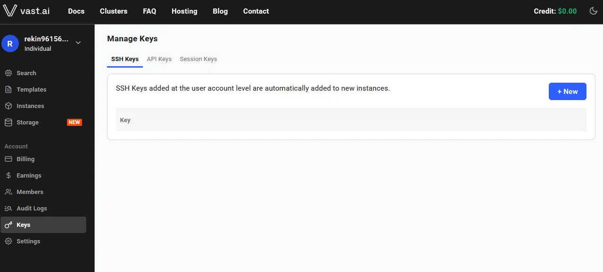
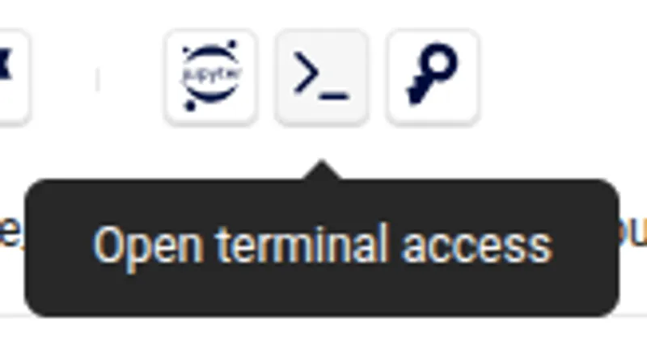
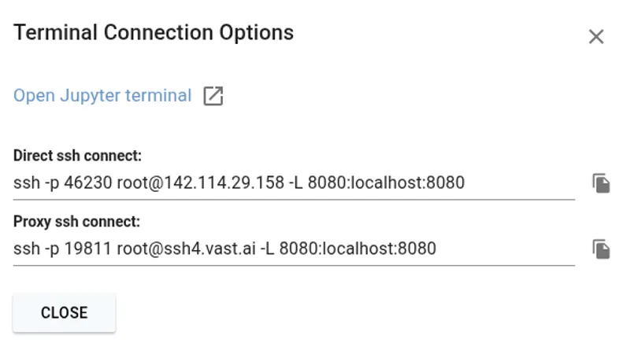
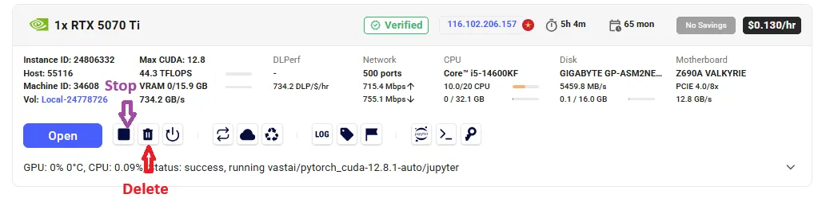

# Vast.ai → Ollama → Claude Code on Windows

Updated against official documentation on **17 November 2026**. Reconstructed and updated from the referenced setup conversation; this is a complete working guide rather than a verbatim transcript.

Your Windows computer runs Claude Code and holds your project files. Ollama and the downloaded model run on a rented Vast.ai GPU. An SSH tunnel connects them:

```text
Windows: Claude Code
        │ http://127.0.0.1:11444
        ▼
Encrypted SSH tunnel using Vast.ai's assigned SSH host and port
        │
        ▼
Vast.ai instance: 127.0.0.1:11434 → Ollama → GPU model
```

This guide covers the Claude Code terminal application. It does not configure the ordinary Claude Desktop chat interface.

## Before you begin

You need Windows with PowerShell and OpenSSH Client, a Vast.ai account with credit, and an SSH-enabled NVIDIA GPU instance. No local GPU or Windows Ollama installation is required for the manual connection used below.

Use three terminal windows:

| Window | Location | Purpose |
|---|---|---|
| A | Windows, then SSH into Linux | Install and manage Ollama |
| B | Windows PowerShell | Keep the SSH tunnel open |
| C | Windows PowerShell | Test the API and run Claude Code |

Commands labeled **Linux** run after connecting to the instance. Commands labeled **PowerShell** run on your Windows computer.

## 1. Prepare your Vast.ai account and GPU

1. Open the [Vast.ai console](https://cloud.vast.ai/), create your account, verify your email, and add billing credit.
2. Create and upload your SSH key using section 2 **before renting**.
3. Choose an Ubuntu-based NVIDIA/CUDA template that supports SSH. A suitable PyTorch template is one option; check the template's launch instructions.
4. Filter offers by GPU VRAM, disk, reliability, bandwidth, and total price. Allow space for model downloads and updates; **80–100 GB disk** is a practical starting allocation for one medium model, not a minimum requirement.
5. Rent the instance and wait until it is running. Open its SSH connection panel.

The main example uses `qwen3-coder:30b`, whose default download is approximately 19 GB. **48 GB VRAM is a conservative starting recommendation** for this example with a 64K context, not a guarantee of fit. A 24 GB card can be tight once runtime and context memory are included. A model's download size is not its complete runtime VRAM requirement. Check actual utilization before committing to a long rental.

The [model library](https://ollama.com/library/qwen3-coder) identifies this model as tool-capable. Choose a smaller tool-capable model if needed, and replace the model name everywhere below. Avoid a `:cloud` tag if your aim is inference on your rented GPU.

Disk allocation cannot currently be resized on an existing instance, so leave headroom. See [Vast.ai's rental quickstart](https://docs.vast.ai/guides/get-started/quickstart).

## 2. Create an SSH key on Windows

**PowerShell — window A:**

```powershell
ssh -V
```

If `ssh` is missing, install **OpenSSH Client** through Windows Optional Features, then reopen PowerShell.

Check for an existing key before generating one:

```powershell
Test-Path "$env:USERPROFILE\.ssh\id_ed25519"
```

If it returns `True`, reuse that key if appropriate. Do not overwrite an existing private key. Otherwise run:

```powershell
ssh-keygen -t ed25519
```

Accept the default location and choose a passphrase. Two files are created:

- `C:\Users\YOUR_USERNAME\.ssh\id_ed25519` — private key; keep it secret.
- `C:\Users\YOUR_USERNAME\.ssh\id_ed25519.pub` — public key; upload this one.

Copy the public key:

```powershell
Get-Content "$env:USERPROFILE\.ssh\id_ed25519.pub" | Set-Clipboard
```

Paste it into the console's [SSH Keys page](https://cloud.vast.ai/manage-keys/). Account keys apply to new instances. For an existing container instance, add the key through its instance-specific SSH panel; VM key changes may require recreation. See the [official SSH guide](https://docs.vast.ai/guides/instances/connect/ssh).



*Illustrative screenshot: [Vast.ai quickstart](https://docs.vast.ai/guides/get-started/quickstart). Interface details may change.*

## 3. Connect from Windows

Copy the SSH command from your running instance. Use its exact hostname, port, and username. Direct SSH is preferable when offered; proxy SSH may use a hostname rather than a numeric IP.





*Illustrative screenshots: [Vast.ai Windows SSH guide](https://docs.vast.ai/guides/instances/connect/windows-guide). Use your own connection values, not the values pictured.*

**PowerShell — window A:** replace the sample values below. `203.0.113.10` is a documentation address, not a live server.

```powershell
$VastSshHost = "203.0.113.10"
$VastSshPort = 23456
$VastSshUser = "root"
$VastKey = "$env:USERPROFILE\.ssh\id_ed25519"
ssh -i $VastKey -p $VastSshPort "${VastSshUser}@${VastSshHost}"
```

At the first connection, verify the host fingerprint against a trusted source if available. Do not dismiss a changed-host-key warning without checking whether the instance was replaced. Enter your key's passphrase when requested.

Once connected, your prompt is a Linux prompt. Check the GPU and disk:

**Linux — window A:**

```bash
nvidia-smi
df -h
```

If the GPU is unavailable, resolve the template/runtime problem before downloading a model. Do not try to repair the physical host's driver from inside the rented container.

## 4. Install and start Ollama

**Linux — window A:**

```bash
curl -fsSL https://ollama.com/install.sh | sh
ollama --version
```

This is Ollama's official installer. Use a current release for Anthropic API compatibility. The [Linux installation documentation](https://docs.ollama.com/linux) covers installation and service management.

Check whether a server is already running:

```bash
curl -fsS http://127.0.0.1:11434/api/tags
```

If this succeeds, do not start a second server. Configure or restart the existing one as needed. Pick **one** startup method below.

### A. Container without systemd: foreground server

Many container templates cannot use `systemctl`. Start Ollama in its own terminal or tmux window:

```bash
export OLLAMA_HOST=127.0.0.1:11434
export OLLAMA_CONTEXT_LENGTH=65536
ollama serve
```

Leave it running. Open another SSH session for model commands. Vast.ai often opens SSH sessions inside tmux; you can create another tmux window with **Ctrl+B**, then **C**. A foreground process without a persistent terminal can end when you disconnect. A stopped or recreated instance still requires Ollama to be started again; tmux does not survive instance termination.

### B. Instance with an Ollama systemd service

If `systemctl status ollama` works and the service exists, configure it with:

```bash
sudo systemctl edit ollama
```

Enter this override:

```ini
[Service]
Environment="OLLAMA_HOST=127.0.0.1:11434"
Environment="OLLAMA_CONTEXT_LENGTH=65536"
```

Then apply it:

```bash
sudo systemctl daemon-reload
sudo systemctl enable --now ollama
sudo systemctl restart ollama
sudo systemctl status ollama
```

Use no `sudo` if your image omits it and you are already root. Environment variables exported in an SSH shell do not reconfigure an already-running service. See [Ollama server configuration](https://docs.ollama.com/faq).

Ollama currently recommends **64K or greater context for coding tools**. Larger context consumes more memory; this guide uses 65,536 tokens. If memory is insufficient, rent more VRAM or use a smaller model. A reduced context can help diagnosis but may constrain Claude Code. See [context length guidance](https://docs.ollama.com/context-length).

Keep Ollama bound to loopback. The tunnel handles remote access; no public port mapping for 11434 is needed.

## 5. Download and test the model

In a second Linux terminal connected to the same instance:

```bash
ollama pull qwen3-coder:30b
ollama ls
ollama run qwen3-coder:30b "Write a Python function that adds two numbers."
ollama ps
nvidia-smi
```

The pull downloads the weights to the remote instance. `ollama ps` shows loaded models, allocated context, and CPU/GPU placement; `100% GPU` is the desired placement for best speed. Run it promptly after inference because idle models can unload. Mixed CPU/GPU placement may explain slow responses.

These commands follow the [Ollama CLI reference](https://docs.ollama.com/cli). Use the exact tag shown by `ollama ls` in all subsequent commands.

## 6. Open the SSH tunnel

**PowerShell — window B:** set your connection values again; variables from window A are not shared automatically.

```powershell
$VastSshHost = "203.0.113.10"
$VastSshPort = 23456
$VastSshUser = "root"
$VastKey = "$env:USERPROFILE\.ssh\id_ed25519"
ssh -i $VastKey -p $VastSshPort -N -T -o ExitOnForwardFailure=yes -o ServerAliveInterval=30 -o ServerAliveCountMax=3 -L 127.0.0.1:11444:127.0.0.1:11434 "${VastSshUser}@${VastSshHost}"
```

After authentication, an empty window with no prompt is normal. Leave it open. **Ctrl+C** closes the tunnel.

- The first `127.0.0.1:11444` is the listening address on Windows.
- The second `127.0.0.1:11434` is Ollama as reached from the remote instance.
- `-N -T` forwards traffic without opening a remote terminal.
- Keepalive options detect a broken connection; they do not reconnect automatically.

This adapts [Vast.ai's local port forwarding instructions](https://docs.vast.ai/guides/instances/connect/ssh). Keep any required proxy options from the command supplied by your instance.

## 7. Test the API from Windows

**PowerShell — window C:**

```powershell
$OllamaUrl = "http://127.0.0.1:11444"
$Model = "qwen3-coder:30b"
(Invoke-RestMethod "$OllamaUrl/api/tags").models | Select-Object name, size
```

Your model should appear. An empty list means you reached a server with no downloaded models. The response format is documented under [list models](https://docs.ollama.com/api/tags).

Test the Anthropic-compatible endpoint before configuring Claude Code:

```powershell
$Body = @{
    model = $Model
    max_tokens = 128
    messages = @(@{ role = "user"; content = "Reply with one short greeting." })
} | ConvertTo-Json -Depth 6
$Reply = Invoke-RestMethod -Uri "$OllamaUrl/v1/messages" -Method Post -ContentType "application/json" -Headers @{ "x-api-key" = "ollama"; "anthropic-version" = "2023-06-01" } -Body $Body -TimeoutSec 300
$Reply.content | Where-Object type -eq "text" | Select-Object -ExpandProperty text
```

A text reply confirms that SSH forwarding, model inference, and the Messages endpoint work together. This follows [Ollama's Anthropic compatibility API](https://docs.ollama.com/api/anthropic-compatibility); support is a subset of Anthropic's API, so feature parity is not guaranteed.

## 8. Install Claude Code on Windows

**PowerShell — window C:**

```powershell
irm https://claude.ai/install.ps1 | iex
```

Open a new PowerShell window when installation finishes, then check:

```powershell
claude --version
claude doctor
```

Use the native Windows installer rather than installing a second copy in WSL for this walkthrough. Git for Windows is recommended for Bash tools; current Claude Code can use PowerShell without it. See [Claude Code installation and Windows setup](https://code.claude.com/docs/en/setup).

## 9. Connect Claude Code to the remote model

In the PowerShell window where you will launch Claude Code:

```powershell
$Model = "qwen3-coder:30b"
$env:ANTHROPIC_BASE_URL = "http://127.0.0.1:11444"
$env:ANTHROPIC_AUTH_TOKEN = "ollama"
$env:ANTHROPIC_API_KEY = ""
$env:ANTHROPIC_DEFAULT_OPUS_MODEL = $Model
$env:ANTHROPIC_DEFAULT_SONNET_MODEL = $Model
$env:ANTHROPIC_DEFAULT_HAIKU_MODEL = $Model
Set-Location "C:\path\to\your\project"
claude --model $Model
```

Replace the project path with an existing folder. The default-model variables keep model-tier selections on a tag your Ollama server actually has. The placeholder token is not a protective password for Ollama.

**Do not append `/v1` to the base URL**: Claude Code constructs the API path. These variables affect this PowerShell process and its children; a different terminal needs them again. See [Ollama's Claude Code integration](https://docs.ollama.com/integrations/claude-code) and its [manual setup source](https://github.com/ollama/ollama/blob/main/docs/integrations/claude-code.mdx).

Inside Claude Code, run `/status` and verify the configured endpoint and model. Begin with:

```text
List the files in this project and explain its purpose. Do not modify anything yet.
```

Then try a small edit after reviewing the requested permissions. File and command tools run on your **Windows computer**; model inference runs remotely. Keep the usual permission prompts enabled.

## 10. Troubleshooting

Work outward in this order: remote GPU → remote Ollama → Windows tunnel → Messages API → Claude Code.

| Symptom | What to check or do |
|---|---|
| `ssh` is not recognized | Install Windows OpenSSH Client and reopen PowerShell. |
| `Permission denied (publickey)` | Confirm the public key is attached to this instance, the private-key path is correct, and the username matches the console. Diagnose with `ssh -vv -i $VastKey -p $VastSshPort "${VastSshUser}@${VastSshHost}"`. |
| SSH times out or is refused | Check instance state and fresh connection details. Try the provided proxy connection if direct SSH is unavailable. |
| Host key changed | Check whether the instance or endpoint was replaced. Verify the new fingerprint before updating the corresponding known-host entry. |
| Tunnel window looks frozen | Normal after successful authentication; test `/api/tags` in another window. |
| Local port already in use | Close the previous tunnel or use local port `11445` in `-L`, all tests, and `ANTHROPIC_BASE_URL`. Remote port stays `11434`. |
| `channel ... connect failed: Connection refused` | SSH works, but the remote Ollama listener is unavailable. Test remote `curl -fsS http://127.0.0.1:11434/api/tags`; start Ollama if necessary. |
| `systemctl` reports systemd is not PID 1 | Use section 4A. This is common in containers. |
| `ollama serve` says address already in use | A server already owns 11434. Check it before starting another. |
| Model not found | Compare the exact tag with remote `ollama ls` and Windows `/api/tags`. Pull it on the remote server. |
| `/api/tags` works but `/v1/messages` fails | Update remote Ollama, check the exact model tag, and retry section 7. A basic model list does not prove Messages compatibility. |
| Claude Code requests login or uses another provider | Reapply variables in the launching terminal. Inspect user/project Claude settings for conflicting endpoint, credential, or model entries. Check `/status`; managed settings may constrain configuration. |
| An unexpected Claude model name is requested | Confirm the three default-model variables and `--model`; remove conflicting project/user model overrides. |
| Out of memory or very slow generation | Check `ollama ps` and `nvidia-smi`; unload unused models with `ollama stop MODEL`, use a smaller model, or rent more VRAM. Large context needs additional memory. |
| Model talks about tools without executing them | Verify tool support, current Ollama/Claude Code versions, and enough context. Try a small task; compatible APIs do not make all models equally capable agents. |
| Downloads fail or disk fills | Check `df -h`, available credit, and outbound connectivity. Allocate more disk on a new instance if needed; remove only models you no longer need. |
| Works until laptop sleeps | Reopen the tunnel and repeat the Windows API test after reconnecting. |

For Ollama logs, inspect the foreground terminal or, for a service:

```bash
journalctl -u ollama -n 100 --no-pager
```

For installation issues, use `claude doctor` and the [official setup guidance](https://code.claude.com/docs/en/setup).

## 11. Reconnect next time and control costs



*Official example of instance management controls. Back up your data before deleting an instance.*

1. Start or resume your Vast.ai instance and copy its current SSH details.
2. Confirm remote Ollama is running; restart it if necessary.
3. Open the tunnel from Windows and test `/api/tags`.
4. Set the Claude Code variables in your launching terminal and start it from your project folder.
5. When finished, exit Claude Code, close the tunnel with Ctrl+C, and stop the rental if you no longer need GPU time.

Closing SSH does not stop rental billing. Stopped instances can still incur storage charges. Back up anything you need before deleting an instance; deletion removes its local data. See [Vast.ai instance management and billing notes](https://docs.vast.ai/guides/get-started/quickstart).


